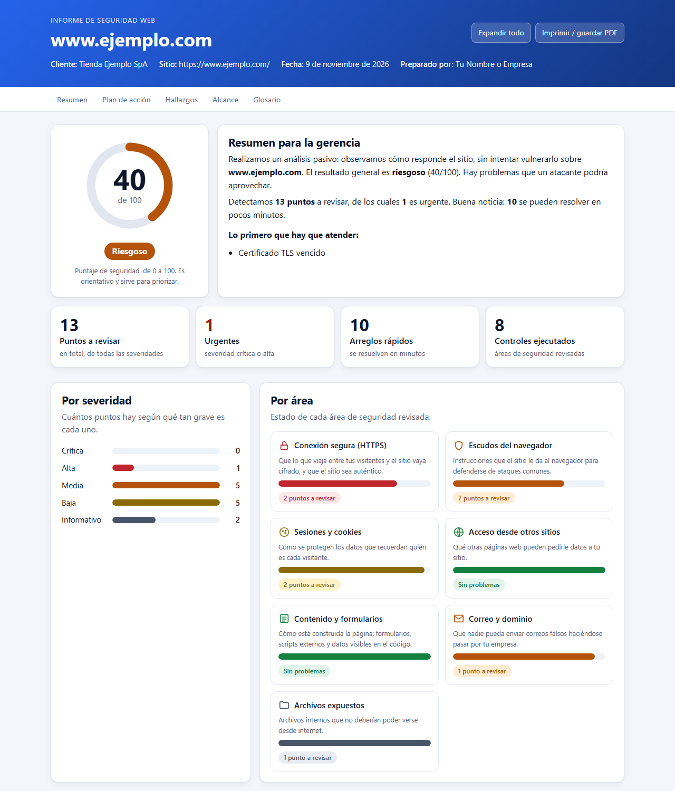
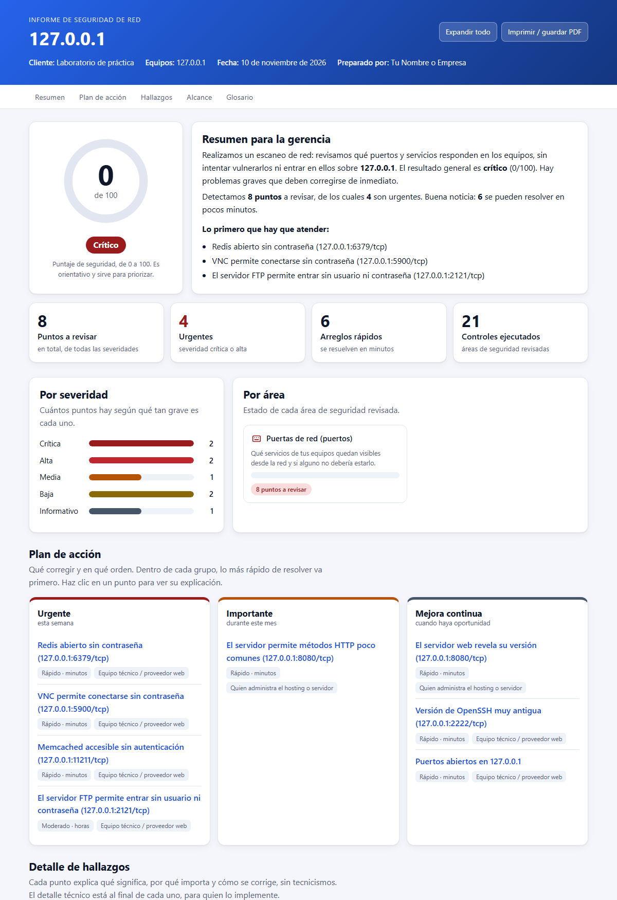

# report-generator

  

Convierte el resultado de un escaneo de seguridad (JSON) en un **informe tipo dashboard**, explicado en lenguaje
simple para que el cliente final entienda qué pasa, por qué importa y cómo se arregla.

- Un solo archivo HTML (sin internet, sin librerías): se puede enviar por correo o abrir en cualquier navegador.
- Exporta a **PDF** con un solo parámetro (usa Edge o Chrome ya instalados).
- Modo claro/oscuro automático, se ve bien en celular y está optimizado para imprimir.
- **No necesita instalar nada**: solo Python (probado con 3.14).



Ejemplo ya generado: [`examples/ejemplo.html`](examples/ejemplo.html) y [`examples/ejemplo.pdf`](examples/ejemplo.pdf)
(datos ficticios).

También genera informes de **seguridad de red** a partir de un escaneo de puertos
([`examples/ejemplo_red.html`](examples/ejemplo_red.html) y [`examples/ejemplo_red.pdf`](examples/ejemplo_red.pdf),
hechos con el laboratorio de práctica de port-scanner):



## Qué incluye el informe

| Sección | Para qué sirve |
|---|---|
| Puntaje y resumen para la gerencia | Una nota de 0 a 100 y un texto claro, sin tecnicismos |
| Indicadores (KPIs) | Cuántos puntos hay, cuántos son urgentes y cuántos se arreglan en minutos |
| Gráficos por severidad y por área | Ver de un vistazo dónde están los problemas |
| Lo que está bien | Áreas revisadas sin problemas (también hay que mostrar lo positivo) |
| Plan de acción | Qué corregir primero, cuánto cuesta en esfuerzo y quién debe hacerlo |
| Detalle de hallazgos | Por cada punto: ¿qué significa?, ¿por qué importa?, ¿cómo se arregla? + detalle técnico |
| Alcance | Qué se revisó y qué límites tiene el informe |
| Glosario | Los términos técnicos que aparecen, explicados en simple |

## Uso rápido

```bash
python -m reportgen examples/ejemplo.json -o informe.html --client "Mi Cliente" --author "Mi Empresa"
```

Opciones:

| Opción | Qué hace |
|---|---|
| `-o archivo.html` | Dónde guardar el informe (por defecto, junto al JSON) |
| `--pdf archivo.pdf` | Genera también un PDF (necesita Edge o Chrome) |
| `--client "Nombre"` | Nombre del cliente en el encabezado |
| `--author "Nombre"` | Quién prepara el informe |
| `--logo logo.png` | Logo en el encabezado (PNG, JPG, SVG, WEBP; máx. 2 MB) |
| `--accent "#0f766e"` | Color principal de tu marca (formato `#RRGGBB`) |

También puedes leer desde la entrada estándar con `-` en lugar del archivo.

## Usarlo con webscan

Primero escanea **solo sitios propios o con autorización por escrito** con
[webscan](https://github.com/MauExpl01t/webscan) y guarda el resultado en JSON:

```bash
python -m webscan scan https://tu-sitio.cl --i-have-authorization --format json -o resultado.json
python -m reportgen resultado.json -o informe.html --pdf informe.pdf --client "Mi Cliente" --author "Mi Empresa"
```

## Usarlo con port-scanner

También entiende el JSON de [`port-scanner`](https://github.com/MauExpl01t/port-scanner) (escaneo de puertos): el informe pasa
a llamarse "Informe de seguridad de red" y explica en simple cada servicio expuesto.

```bash
python -m portscanner scan 192.168.1.10 -A --i-have-authorization --format json -o resultado.json
python -m reportgen resultado.json -o informe.html --pdf informe.pdf --client "Mi Cliente"
```

## Formato del JSON de entrada

Cualquier herramienta puede alimentar este generador si entrega este formato (es el mismo de `webscan --format json`):

```json
{
  "target": "https://www.ejemplo.com/",
  "started_at": "2026-11-09T14:02:11+00:00",
  "checks_run": ["headers", "tls"],
  "errors": [],
  "findings": [
    {
      "check": "headers.hsts",
      "title": "Falta Strict-Transport-Security (HSTS)",
      "severity": "MEDIUM",
      "description": "Lo que detectó la herramienta",
      "recommendation": "Recomendación técnica",
      "evidence": "Opcional: prueba concreta",
      "reference": "https://... (opcional)"
    }
  ]
}
```

- Obligatorios: `target` y, en cada hallazgo, `title`.
- `severity`: `CRITICAL`, `HIGH`, `MEDIUM`, `LOW` o `INFO` (otro valor se trata como `INFO`).
- `score` es opcional: si falta, se calcula (100 menos 30/15/7/2 por cada hallazgo crítico/alto/medio/bajo).
- `check` identifica el tipo de hallazgo. Si el id está en [`reportgen/knowledge.py`](reportgen/knowledge.py) el informe
  usa la explicación didáctica; si no, muestra una explicación genérica y tu recomendación técnica.

## Agregar o mejorar explicaciones

Todo el texto para el cliente vive en `reportgen/knowledge.py`. Para un chequeo nuevo, agrega una entrada en el
diccionario `KB` con: qué significa (con una analogía), por qué importa, cómo se arregla, esfuerzo y responsable.

## Seguridad del informe

- Todo el texto que viene del JSON se escapa, así que un dato malicioso no puede inyectar código en el HTML.
- Solo se enlazan referencias `http://` y `https://`.
- El HTML no carga nada externo (ni fuentes, ni scripts, ni imágenes remotas).
- Los informes reales contienen información sensible del cliente: no los subas a GitHub (el `.gitignore` ya los excluye).

## Pruebas

```bash
pip install pytest
python -m pytest
```

## Aviso

El puntaje es orientativo y el informe es una fotografía del momento. No reemplaza una auditoría de seguridad completa.

## Qué demuestra este proyecto

- **Comunicación técnica para no técnicos**: una base de conocimiento (`reportgen/knowledge.py`) traduce cada hallazgo a
  "qué significa, por qué importa y cómo se arregla", con analogías, esfuerzo y responsable.
- **Generación segura de HTML**: todo el texto externo se escapa, solo se enlazan `http(s)`, sin recursos externos.
- **Ingeniería de la salida**: un solo archivo HTML (modo claro/oscuro, responsive, listo para imprimir) y exportación a PDF
  con el Edge/Chrome instalado, sin dependencias de Python.
- **Pruebas automáticas** del modelo, la lógica de puntaje, el render y los textos.

## Licencia

MIT. Ver [LICENSE](LICENSE).
